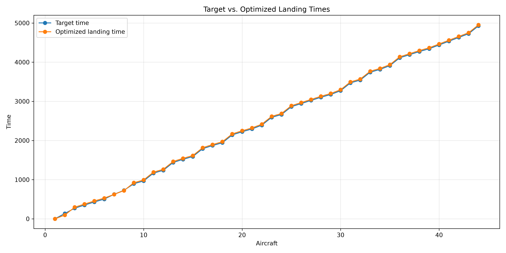
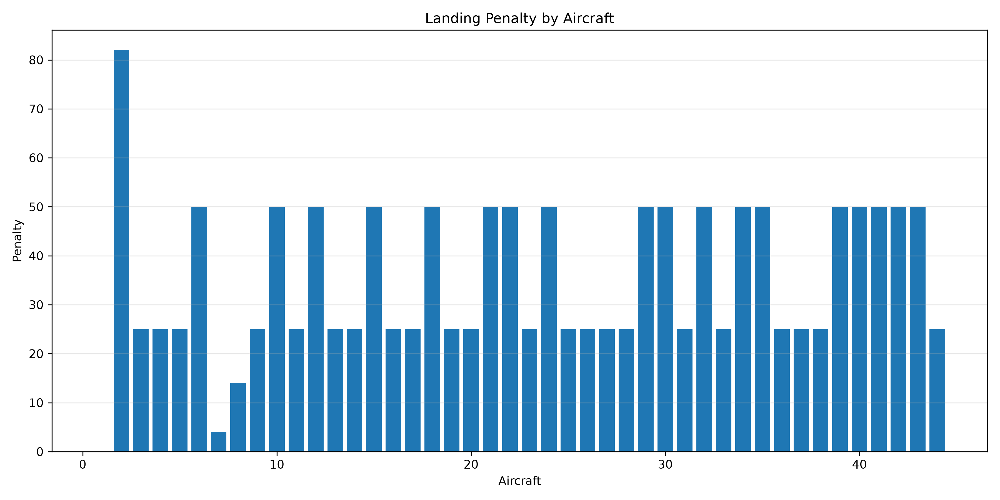
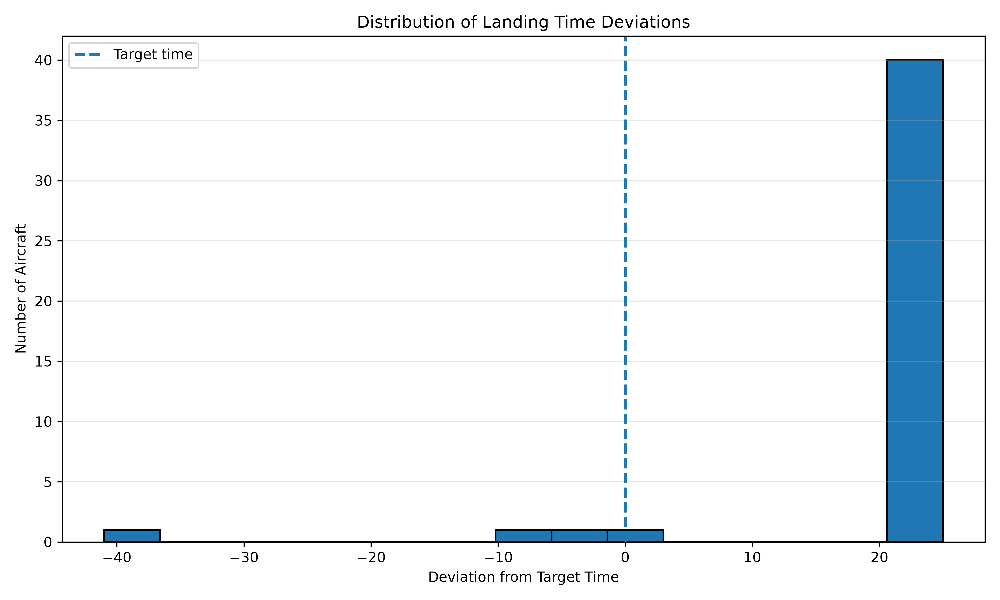

# Aircraft Landing Optimization with Gurobi

This project formulates and solves a **single-runway Aircraft Landing Problem (ALP)** using Mixed-Integer Linear Programming (MILP) and the Gurobi Optimizer.

The objective is to determine aircraft landing times and sequence while satisfying landing-time windows and sequence-dependent safety separation requirements. Deviations from preferred target landing times incur earliness or lateness penalties.

The project uses the **`airland7` benchmark instance from Brunel University's OR-Library**, containing **44 aircraft**.

## Problem Formulation

For each aircraft $i$:

- $E_i$: earliest allowable landing time
- $T_i$: preferred target landing time
- $L_i$: latest allowable landing time
- $c_i^E$: penalty per unit of earliness
- $c_i^L$: penalty per unit of lateness
- $s_{ij}$: required safety separation if aircraft $i$ lands before aircraft $j$

The primary decision variable is

$$
t_i = \text{actual landing time of aircraft } i.
$$

An auxiliary binary sequencing variable is used for each aircraft pair:

$$
x_{ij} =
\begin{cases}
1, & \text{if aircraft } i \text{ lands before } j,\\
0, & \text{if aircraft } j \text{ lands before } i.
\end{cases}
$$

Earliness and lateness are

$$
e_i = \max(T_i-t_i,0),
\qquad
l_i = \max(t_i-T_i,0).
$$

The objective is

$$
\min \sum_i \left(c_i^E e_i+c_i^L l_i\right).
$$

### Landing-window constraints

$$
E_i \le t_i \le L_i.
$$

### Safety-separation constraints

If aircraft $i$ lands before aircraft $j$,

$$
t_j \ge t_i+s_{ij}.
$$

The sequencing disjunction is represented with pair-specific Big-M constraints:

$$
t_j \ge t_i+s_{ij}-M_{ij}(1-x_{ij}),
$$

$$
t_i \ge t_j+s_{ji}-M_{ji}x_{ij}.
$$

Tight pair-specific Big-M values are calculated from the aircraft landing windows rather than using an arbitrary large constant.

## Data

Source: **J. E. Beasley's OR-Library, Brunel University**

https://people.brunel.ac.uk/~mastjjb/jeb/orlib/airlandinfo.html

The raw `airland7.txt` benchmark is converted into:

- `aircraft.csv` — one-dimensional aircraft parameters
- `separation.csv` — the two-dimensional separation matrix $s_{ij}$

## Results

The optimized schedule is stored in:

```text
results/landing_schedule.csv
```

For `airland7`, the resulting objective value is:

$$
\boxed{1550.00}
$$

### Target vs. Optimized Landing Times



This plot compares each aircraft's preferred target time with its optimized landing time.

### Penalty by Aircraft



This plot shows each aircraft's contribution to the total earliness/lateness penalty.

### Distribution of Landing Deviations

Define

$$
d_i=t_i-T_i.
$$

Thus:

- $d_i<0$: early
- $d_i=0$: on target
- $d_i>0$: late



The histogram shows the distribution of early and late landing deviations across the optimized schedule.

## Independent Validation

The saved optimization result is independently validated using the original processed data rather than the Gurobi model.

The validation checks:

- landing-time windows;
- pairwise safety separations;
- earliness and lateness calculations;
- individual penalty calculations;
- reconstructed total objective.

The validation output is:

```text
Landing windows:       PASSED
Safety separation:     PASSED
Penalty calculations:  PASSED

Recalculated objective: 1550.00

VALID SOLUTION: ALL CHECKS PASSED
```

## Project Structure

```text
project/
├── data/
│   ├── airland7.txt
│   └── processed/
│       ├── aircraft.csv
│       └── separation.csv
├── results/
│   ├── landing_schedule.csv
│   └── plots/
│       ├── target_vs_optimized.png
│       ├── penalty_by_aircraft.png
│       └── landing_deviation_histogram.png
├── 0_download_data.py
├── 1_cleaning.py
├── 2_optimize.py
├── 3_validate_and_plot.py
├── pyproject.toml
├── uv.lock
└── README.md
```

## Technologies

- Python 3.12
- Gurobi Optimizer / `gurobipy`
- pandas
- matplotlib
- uv

## Run the Project

Install dependencies:

```bash
uv sync
```

Download the benchmark:

```bash
uv run python 0_download_data.py
```

Process the raw data:

```bash
uv run python 1_cleaning.py
```

Run the optimization:

```bash
uv run python 2_optimize.py
```

Validate the saved solution and generate plots:

```bash
uv run python 3_validate_and_plot.py
```

## Key Features

- Mixed-Integer Linear Programming
- sequence-dependent scheduling
- binary precedence decisions
- pair-specific Big-M linearization
- aircraft-specific earliness and lateness penalties
- Gurobi optimization
- independent solution validation
- optimization-result visualization
